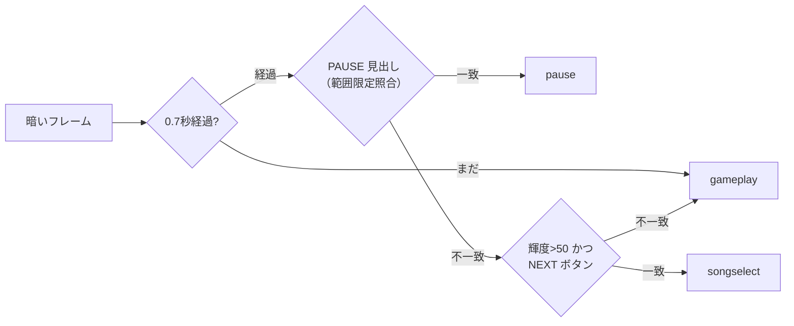
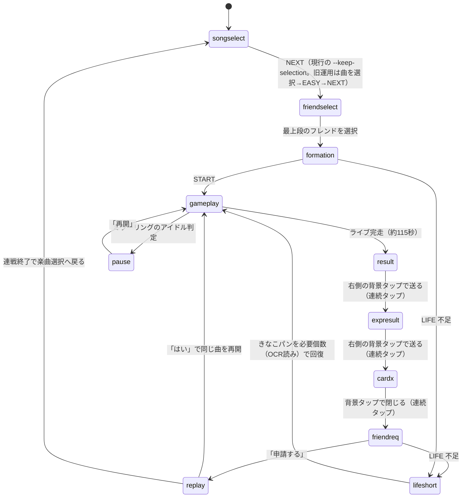
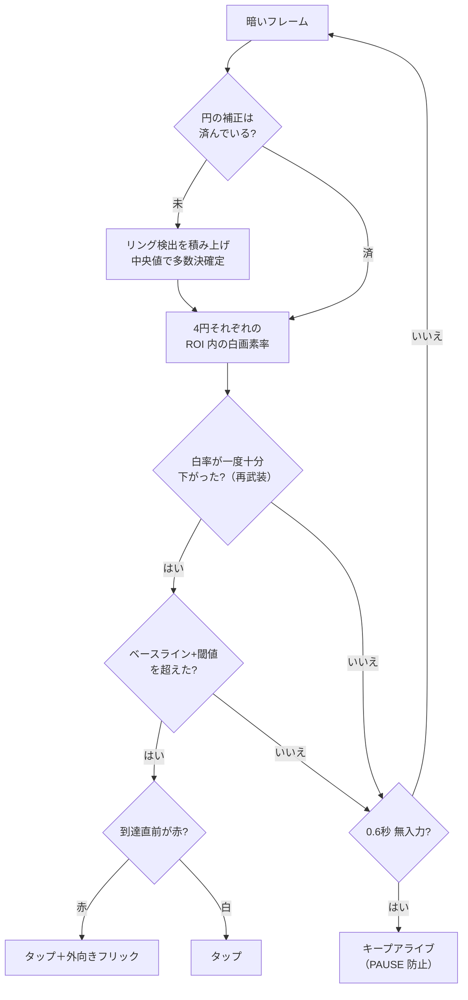
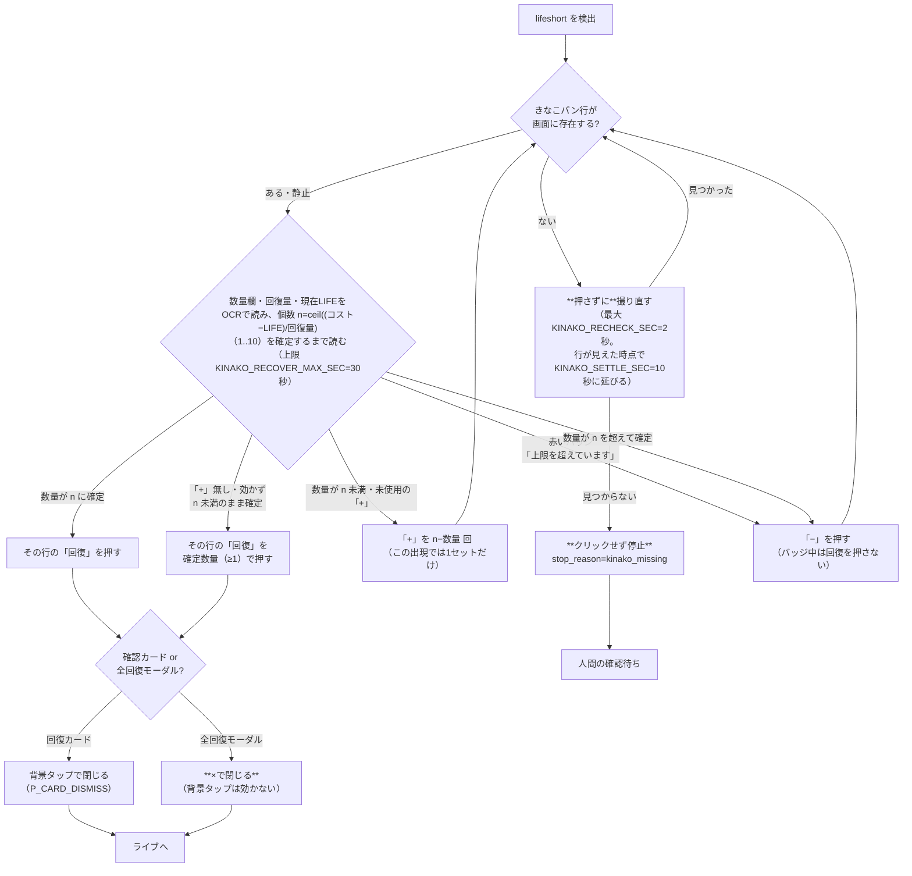
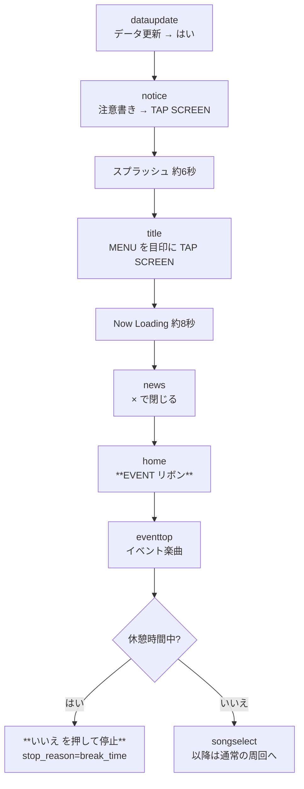

# 画面遷移仕様

このツールが認識する画面（状態）と、各画面で何をするかの仕様。**コードが真実**なので、
`tools/autolive.py` の `TEMPLATES` / `detect()` / `_loop()` を変更したら本書も更新すること
（更新手順は末尾「本書の保守」を参照）。

対象コミット時点の実装から機械的に抽出している。役割の違いに注意:

| 文書 | 中身 | 更新するとき |
|---|---|---|
| **本書** | 実装から抽出した**現在の仕様**（何をどの順で判定し、何をするか） | **実装を変えたとき** |
| [`navigation.md`](navigation.md) | イベント導線と実測座標 | イベントが変わったとき |
| [`device-findings.md`](device-findings.md) | なぜその実装になったかの経緯 | 新しい知見を得たとき |

---

## 1. 全体像

周回は3層のプロセスで動く。**画面遷移を扱うのは最下層の `autolive.py` だけ**で、
上位2層はプロセスの生死だけを見る。

```mermaid
flowchart TD
    R["run_until.sh<br/>指定時刻まで回す<br/>切断中は待機<br/>Macロックは解除を促す<br/>引数なしなら対話で設定"]
    S["supervise_autolive.sh<br/>落ちたら再起動<br/>rc=42 なら再起動しない"]
    A["autolive.py<br/>画面認識と打鍵"]
    R -->|connected() が真なら起動| S
    S -->|残り時間ぶん起動| A
    A -->|rc=0 正常終了| S
    A -->|rc=42 安全停止| S
    S -->|安全停止/空転打ち切り| R
    R -->|接続あり＋要人手| STOP["runner 終了<br/>人間の確認待ち"]
    R -->|接続なし| WAIT["30秒待機して再確認"]
    WAIT --> R
```

- `connected()` は「ウィンドウが横向き」かつ「`detect()` が `menu` 以外」を接続とみなす。
  ゲームは常に横向きなので、**縦長＝ミラーリング切断ダイアログ**。
- `--max-seconds` の時間上限では **`SAFE_EXIT_STATES`（リザルト系〜編成・LIFE 不足）でだけ抜ける**。
  ライブ中はもちろん、START 直後や LIFE 回復直後のローディング（判定は `menu`）でも抜けない
  （上限を `MAX_SECONDS_GRACE`=300 秒以上超えたら諦めて抜ける）。締め時刻で最後のライブを
  途中放棄・無人化して LIFE を無駄にしないため（2026-09-12、ローディングで抜けた実害あり）。
- `rc=42`（`EXIT_SAFE_STOP`）は「人間の確認が必要な停止」。再起動しても同じ画面で
  止まるだけなので、supervisor も runner も再起動しない。

## 2. 画面の判定方法

毎フレーム、次の順で判定する（`detect()`）。**順序が仕様の一部**で、入れ替えると誤判定する。

### 2.1 まず明るさで二分する

| 条件 | 意味 |
|---|---|
| 平均輝度 < `DARK_THRESH`(65) | ライブ中または PAUSE（暗い画面） |
| 65 ≦ 平均輝度 < `DIM_THRESH`(90) かつ タップ円のリングが 3 円以上見える | ライブ中（薄暗い側として扱う） |
| それ以外（≧ 65） | メニュー・ダイアログ（明るい画面） |

リングの有無は `_rings_visible()`。ライブ中の内容輝度は曲や演出で 35〜52 まで動き（2026-09-12 実測）、
輝度だけでは明るい側に落ちて全段照合（2.9 秒・打鍵停止）とクリア計上漏れを起こしたため。

平均輝度は `frame_brightness()` で測る。**上端 38 行を 210（較正時のタイトルバーの明るさ）に
置き換えて平均する**。現在のウィンドウはタイトルバーが無く、上端が透過して背後のウィンドウが
写り込む（実測: 暗いページで 28、白い Chrome で 252）。生の平均だと ±20 動き、暗いメニューが
gameplay に落ちたり（2026-09-10）、ライブ中の再照合が4倍重くなったり（2026-09-11）した。

**暗い側ではテンプレ照合を間引く**（`DARK_RECHECK_SEC` = 0.7 秒おき）。
毎フレーム照合すると打鍵ループが 3.3 FPS まで落ちる（実測。
[`device-findings.md`](device-findings.md)「打鍵ループが 3.3 FPS しか出ていなかった」）。

**明るい側では全キーの照合を先に並列で投げる**（`BRIGHT_KEYS` を常駐スレッドプール
`match_pool()`、`MATCH_WORKERS`=8 へ）。`m("key")` はその結果を 2.3 の順に読むだけなので、
**判定順も結果（state・スコア・位置）も直列照合と同一**で、待ち時間だけが並列になる
（コーパス・フィクスチャ・実機フレーム 668 枚で一致を確認。明るいフレームの detect は
平均 1994ms → 898ms。`tests/test_detect_prefetch.py` が `BRIGHT_KEYS` と `m()` の並びを突き合わせる）。
状態が決まった時点で残りの照合は取り消す。**暗い側では投げない**（打鍵ループの CPU を奪わない）。

### 2.2 暗い側の判定



PAUSE の照合は `PAUSE_SEARCH_BOX`(0.25, 0.10, 0.75, 0.55) に限定している。
全画面照合は 1 回 147〜246ms かかり、打鍵ループを潰すため。


**`dailytask`（イベントトップの「本日の課題」）も暗い側で判定する。** mean≈58 と
`DARK_THRESH`(65) を下回るため、放置すると打鍵エンジンが動き、円の位置にある
「イベント楽曲へ」ボタンを叩いて制御外の遷移を起こす（実測 2026-08-03）。
`songselect` 救済と同じ間引き枠に相乗りするので、ライブ中の追加コストはほぼ無い
（gameplay 40 フレーム中 mean>50 は 1 枚だけ）。

**`eventresult`（EVENT RESULT の pt 画面）も暗い側で判定する。** イベントテーマによっては
mean≈57 まで落ちる（実測 2026-09-10、KEEP OUT テーマ）。放置すると打鍵エンジンが円の位置を
盲目打鍵し、進むまで 40〜130 秒を浪費するうえ、`MIN_LIVE_SEC` を超えて**偽クリアを二重計上**する。
見出しは左上に固定なので `EVENTRESULT_SEARCH_BOX` に絞って照合し、同じ間引き枠に相乗りする。
**暗い側の救済照合（songselect / dailytask / eventresult）はすべて探索範囲を絞る。**
ウィンドウ上端の透過部に明るい別ウィンドウが写り込むだけで輝度が 50 を超え、全画面照合のままだと
0.7 秒ごとの再照合が 26ms → 297ms に跳ねてループ時間の約4割を失う（実測 2026-09-11、グレード C）。
回帰テストは `tests/test_detect_dialogs.py`（`eventresult_dark_671x348.png`）。

**`imessage`（iOS の「iMessage と FaceTime をオンにしますか？」）も暗い側で判定する。** iOS の
システムダイアログは画面全体を暗転させ、編成画面の上では mean≈64 と `DARK_THRESH` を下回る
（実測 2026-09-16 07:39）。放置すると gameplay 扱いのまま 240 秒で `gameplay_timeout` 停止 → runner 終了
（人手で復旧）。見出しを `IMESSAGE_SEARCH_BOX` に絞って同じ間引き枠で照合し、**「使用しない」だけを押す**
（「オンにする」は SMS 送信で課金され得ると明記されている）。回帰テストは `imessage_prompt_671x348.png`。
同系統の **`icloudsync`（「一部の iCloud データは同期していません」）** も同じ扱い（実測 2026-09-16 19:43、
EVENT RESULT の上に出て `unknown_screen` 停止）。**「今はしない」だけを押す**（「データの同期を再開」は端末設定を変える）。
回帰テストは `icloud_sync_671x348.png`。
### 2.3 明るい側の判定順（上から順に評価）

| # | 状態 | 判定 | なぜこの位置か |
|---|---|---|---|
| 1 | `pause` | PAUSE 見出し | |
| 2 | `imessage` | iOS「iMessage と FaceTime をオンに」→ **使用しない** | `battery` と同じく最優先。暗い側でも判定（2.2） |
| 3 | `icloudsync` | iOS「一部の iCloud データは同期していません」→ **今はしない** | 同上 |
| 4 | `battery` | iOS バッテリー警告の「閉じる」 | 放置すると未知画面で停止する |
| 5 | `lifeshort` | 「ライフが足りません。」 | **課金事故防止のため最優先級**。盲目タップさせない |
| 6 | `friendreq` | EVENT RESULT の「申請する」 | |
| 7 | `replay` | 「連続ライブ」見出し | |
| 8 | `rankup` | 「RANK UP!」 | |
| 9 | `dldialog` | 「…をダウンロードします。」 | `closex` が誤マッチ(≈0.93)するので先に。しきい値 0.80（2026-09-15 に 0.849 で取り逃がし `cardx_stuck` 停止。非DL画面の最大は 0.584） |
| 10 | `story` | 「ストーリー開放チケット…」 | ×が無く いいえ/はい なので `closex` より先に |
| 11 | `resumelive` | 「前回のライブを再開しますか？」 | シアン系ヘッダを持つので `cardx` より先に |
| 12 | `dataupdate` | 「データ更新のためタイトルへ戻ります」 | 同上 |
| 13 | `resendresult` | 「前回のライブ結果の送信が…」 | 同上 |
| 14 | `neterror` | 「通信エラーが発生しました。」→ **リトライ** | シアン系ヘッダを持つので `cardx` より先に。「諦める」を押すとその周回を落とす |
| 15 | `nettimeout` | 「通信がタイムアウトしました。」→ **諦める** | 同上。ボタンは「諦める」1個だけ（リトライ無し）。`cardx` に流れて背景タップでは閉じられず `cardx_stuck` で停止した（2026-10-15 実機） |
| 16 | `supported` | 「…サポートしました。」→ **はい** | **×が無い**ので `cardx` の背景タップでは閉じられない |
| 17 | `liveassist` | ライブアシスト選択 | `formation`・色検出より先に |
| 18 | `formation` | START ボタン | イベント装飾の帯を `cardx` と誤検出させないため |
| 19 | `breaktime` | 「休憩時間中はイベントPtを…」 | **必ず `eventtop` より先。** 背後の「イベント楽曲」が 0.943 で当たるため |
| 20 | `title` | **右下の MENU ボタン**（しきい値 0.92、variant `title_menu_event*.png` はイベント開催中のキービジュアル版。`_event3` = 2026-09-30 追加：`_event` が 0.901 で僅差未達→ unknown_screen 停止＋runner の切断待機化を防ぐため） | **`formation` より後ろ。** 編成画面の MENU が 0.889 で当たるため |
| 21 | `notice` | 起動時の注意書きの「TAP SCREEN」 | |
| 22 | `news` | ヘッダ「お知らせ」 | シアン系ヘッダを持つので `cardx` より先に |
| 23 | `eventtop` | 「イベント楽曲」ボタン | |
| 24 | `loginbonus` | 「LOGIN BONUS」見出し | 04:00 リセットでホームの上に出る。ピンクのヘッダで `cardx` に掛からない。背後の EVENT 帯が当たるので `home` より先 |
| 25 | `speciallogin` | 「…特別ログインボーナスをプレゼントいたします！」定型文 | イベント期間中 1 日 1 回。ログインボーナスの後に出る。画面タップで進む |
| 26 | `home` | EVENT ラベル帯（**色はイベントごとに変わる**。ベージュ→オレンジ。`home_event*.png` の variant で追従） | 同上。ラベルが外れると明るいキービジュアルを `cardx` が拾って停止する（2026-09-12） |
| 27 | `dailytask` | 「本日の課題」見出し | カード型ポップアップなので `cardx` より先。暗い側でも判定する（2.2） |
| 28 | `lifefull` | 「ライフを全回復しました。」本文 | **背景タップでは閉じない ×必須のモーダル**。`songselect`・`cardx`・`closex` より先: 楽曲選択や EVENT RESULT の上に重なって出るため、NEXT や closex(0.88) が背後に当たると永遠に閉じない（2026-10-11 実機: NEXT 約30回を飲み込む／cardx の背景タップ約30回で `cardx_stuck`） |
| 29 | `songselect` | NEXT ボタン | **`cardx` より先。** イベント楽曲リスト上部の薄い水色の区切り線（高さ2px）を `detect_card_x` がシアン帯として拾うため cardx と誤検出され、背景タップでは閉じられず 28 秒で安全停止していた（2026-08-28 実機） |
| 30 | `expresult` | 「獲得キャラEXP」 | カードの緑ヘッダを `cardx` が拾うので先に |
| 31 | `friendselect` | フレンド選択 | **`cardx` より先。** 画面上部の薄い水色の装飾帯（y≈0.11〜0.17）が `detect_card_x` のシアン帯条件を満たし、誤判定→背景タップ停滞→ `cardx_stuck` で 6クリアごとに停止していた（2026-09-30 実機、4連続再現。テンプレ側は 0.925 で正常一致） |
| 32 | `cardx` | シアン→緑のヘッダ帯を**色検出** | テンプレ非依存（端末非依存） |
| 33 | `closex` | ポップアップ右上の× | |
| 34 | `eventresult` | EVENT RESULT 見出し | |
| 35 | `result` | per-song「Result」 | 閾値 0.55 と低いが、誤検出しても中央タップのみで安全 |
| 36 | `formation` | START ボタン（再判定） | |
| 37 | `menu` | **どれにも当てはまらない** | **クリックせず待つ**。25秒で安全停止 |

**`menu` は「未知の明るい画面」**であり、絶対にクリックしない。課金ボタンの誤タップを
避けるための設計で、これを崩してはいけない。

## 3. 周回のメインループ

正常時の1周（約88〜130秒）。



各状態でやること:

| 状態 | 操作 | 補足 |
|---|---|---|
| `songselect` | **左下にイベントバッジがあれば通常ライブの楽曲選択なので NEXT を押さず、バッジでイベントトップへ**（絶対規則 3）。それ以外は、**現行運用の `--keep-selection`（2026-10-20 ユーザー指定・難易度は人が選んだまま継続）では NEXT のみ**。旧運用の既定経路では対象曲を選択 → EASY タブ → NEXT | 既定経路では曲テンプレに一致しなければ**曲を変更しない**（安全側）。NEXT の後は**画面が変わるまで**（最大 1.4 秒）待つ。**変わらないまま `SONGSELECT_NOCHANGE_MAX`(6) 回続いたら `songselect_stuck` で停止**（「ライフを全回復しました。」等の見えない蓋に NEXT が飲まれた場合。2026-10-11 実機で約30回・60秒の空打ちが起きた） |
| `friendselect` | **一覧が静止してから**、必ず最上段の行をタップ | `match_topmost()`。最良スコアだと行が定まらない。遷移アニメ中のタップは無視されるため、静止した新しいフレーム（0.25 秒差の2枚がほぼ同じ）で行を探し直して押す（旧: 1回目が無視され次の detect の 4 秒後に押し直していた）。押した後は画面が変わるまで（最大 1.0 秒）待つ |
| `formation` | START | 直後 `CARDX_SUPPRESS_SEC` の間は `cardx` を無視する。**クリアを挟まず 2 回目の START になったら押さずに停止**（`live_abandoned`） |
| `gameplay` | ノーツ到達を検出して打鍵 | 別章「4. ライブ中」参照 |
| `pause` | 固定位置の「再開」をクリック | 見出しテンプレの位置ではなくボタン位置 |
| `result` / `eventresult` / `expresult` | **右側の背景**（`P_CARD_DISMISS`）をタップし、送り画面のままである間は**続けて叩く**（`_advance_burst`） | 1打ごとに「静止している」「LIFE不足・連続ライブ・RANK UP・楽曲選択・カードが重なっていない」「まだ Result 系」を確かめる。同じ状態に `ADVANCE_ALT_SEC`(10 秒) 留まったら、その状態だけ従来の中央送り（`OFF_RESULT_ADV`）に戻す |
| `cardx` | **背景**をタップして閉じる（`P_CARD_DISMISS`）。同じ見た目のカードである間は**続けて叩く**（`_advance_burst`） | ×の色検出位置は背景次第でぶれるため。着弾点は**右上を避けて縦中央**（右上は BACK と**ステラ購入の「＋」**が並ぶ。旧値は「＋」と 9px しか離れていなかった）。左下も不可（Dock／ホットコーナー）。**色検出は LIFE不足・連続ライブのダイアログにも当たる**ので、連続タップは detect が識別した画面とほぼ同じ見た目（`ADVANCE_SAME_DIFF` 未満）で、かつ両ダイアログのテンプレが当たらないときだけ叩く |
| `closex` | ×候補を順にタップ | |
| `home` | EVENT リボン。**5 回押しても変わらなければ下部ナビ LIVE から迂回**（2026-09-12: リボンが無反応） | 迂回先の通常楽曲選択はバッジでイベントトップへ戻る |
| `loginbonus` | 画面タップで送る（`P_CARD_DISMISS`） | 04:00 リセットのログインボーナス。2 ページあり、どこをタップしても進む |
| `speciallogin` | 画面タップで送る（`P_CARD_DISMISS`） | イベントの特別ログインボーナス（1 日 1 回） |
| `friendreq` | 「申請する」（実際は連続ライブ「再プレイしますか？」の**はい**） | ここでクリア数を計上する。**押す直前に静止した新しいフレームで「はい」が同じ位置にあり LIFE 不足ではないことを確かめる**（直後に出る LIFE 不足ダイアログでは、この位置の 6px 上がステラ行の「回復」）。押した後は画面が変わるまで（最大 1.5 秒）待つ |
| `replay` | 「はい」 | 同じ曲を再開 |
| `lifeshort` | きなこパンを **OCR で読んだ必要個数** `n = ceil((コスト−現在LIFE)/1個の回復量)`（1..10）で1回だけ回復 | 別章「5. 課金事故を防ぐ設計」参照。回復量はイベントで変わるので**固定値は持たない** |
| `lifefull` | 「ライフを全回復しました。」本文のマッチ位置からのオフセットで**カード右上の × を押す**（`ANCH_LIFEFULL_X`） | きなこパン回復で LIFE が上限に達すると出る。**背景タップでは閉じない**（実機: `P_CARD_DISMISS` 約30回でも残った）。押した後は画面が変わるまで（最大 1.5 秒）待つ |
| `dldialog` | 「ダウンロード」 | |
| `story` | **いいえ** | 周回を続ける |
| `liveassist` | 何も選ばず START | アイテム消費ゼロ |
| `battery` | 「閉じる」 | |
| `imessage` | 「使用しない」 | iOS の iMessage/FaceTime 有効化確認。**「オンにする」は SMS 課金の可能性があるので絶対に押さない** |
| `icloudsync` | 「今はしない」 | iOS の iCloud 同期確認。「データの同期を再開」は端末設定を変えるので押さない |
| `menu` | **何もしない** | 25秒で安全停止 |

## 4. ライブ中（`gameplay`）



- **円座標は機種で数十px ずれる**。`--auto-circles` で実測に補正し、
  `.autocal_circles.json` にキャッシュして次回起動時に即復元する。
  補正しないと MISS 51・グレード B まで落ちる（実測）。
  補正値は**コミット前・キャッシュ読込時の両方で幾何検証**する（4円の左右対称性と
  prior からの跳躍上限）。装飾の誤検出で悪い値が確定し、prior として回り続ける
  構造を防ぐため（2026-10-12、円4 が 27px 外れて全ノーツ見送りの事故）。
- **キープアライブは必須**。無入力が続くとミラーリングがアイドル判定して PAUSE する。
- ループ末尾の `time.sleep(0.005)` は**外してはいけない**。外すと 48 FPS まで上がるが
  打鍵精度が有意に悪化する（PERFECT 54.5→37.5、3.5σ）。
- **gameplay は「演出の切れ目」では継続とみなす。** ライブ中に明るい演出が入ると数秒
  `menu` に誤判定されるが、`gameplay`/`pause` 以外の画面が `GAMEPLAY_GAP_SEC`(4 秒) 以内なら
  `gameplay_since` をリセットしない（クリア計上 `was_in_live` のため。演出ごとにリセットすると
  クリアが 1 回も計上されず、2 回目の START で `live_abandoned` まで行く。2026-10-11 実機で既遂）。

## 5. 課金事故を防ぐ設計

**ステラストーン（課金アイテム）を絶対に消費しない**ことが最優先の要件。過去に一度、
実際に消費してしまった事故がある。



きなこパンが 0 個になると、ダイアログは**その行をグレーアウトせず行ごと消して上に詰める**。
そのため見出し基準の固定オフセットではステラの「回復」を直撃する。実機でステラ所持が
58→55→52 と減っていた。

対策は「**押す前にきなこパン行が実在することを画像で確認し、その行の「回復」ボタンを押す**」。
行が無ければクリックせず停止する。回帰テストは `tests/test_life_recover_safety.py`。

**押す位置はラベル基準の固定オフセットではなく、ボタンをピンク色で直接探す**
（`kinako_recover_point()`）。固定オフセットはラベルのマッチ中心が基準なので、
**ラベルに接頭辞が付くとそのぶん着弾点がずれる**。実機 2026-08-28、イベント配布の
**「11周年きなこパン」**（所持154個）でラベル中心が 311→346 と 35px 右へ動き、着弾が
x=443 となってボタン右端(441)を 2px 外した。回復が6回連続で空振りし
`life_short_persist` で停止（**ステラは押していないので課金事故ではない**が周回は止まる）。
ボタン自体の位置は接頭辞の有無で変わらない（両フレームとも x=386..441, y=164..185）。

候補は「**きなこパン行と同じ高さ**（フレーム高の 0.13 以内）**でラベルより右**にある
横長のピンク矩形」に限る。ステラ行のボタンは 0.26h ぶん離れているので混ざらない。
見つからないときだけ従来の固定オフセットへフォールバックする（行の実在は確認済みなので
フォールバック先もきなこパン行の中に収まる）。

**きなこパンの使用個数は固定値を持たない（2026-10-20 改訂）。** 1個あたりの回復量は
イベントで変わる（ユーザー指定: 共鳴=30、旧イベント=20、例として 5 もありうる）。
個数はダイアログ上で `n = ceil((コスト − 現在LIFE) / 1個の回復量)`（1..`KINAKO_MAX_PER_RECOVER`=10）
として毎回決める。読み取りは **Apple Vision OCR**（`tools/ocr.py`・`VNRecognizeTextRequest`・
言語補正OFF・切り出し3倍拡大。1切り出し ~23ms、最初の1回だけ ~25s なので起動時に
バックグラウンドでウォームアップ）:
- **1個の回復量**: きなこ行ラベル `…きなこパン：LIFE N 回復` を行基準で切り出し、
  `LIFE\s*(\d+)\s*回復` の数字だけを使う（接頭辞は誤読されうる。共鳴→共期・バン等）。
- **現在 LIFE**: ダイアログ右上 `LIFE ♥ N`。ピルの白い1桁は落ちやすいので
  白文字二値化で読み直す（「6」「0」も読める）。
- **コスト**: フレンド選択・編成画面の上部バッジ `♥-N` を見かけた時点で覚える
  （未取得なら観測最大 100 に縮退）。回復量・現在 LIFE が読めなければ n=1（安全側）。
- **数量欄**: 整数で読む。「1」は OCR が落とすので従来の `kinako_qty_is_one`
  （画素の縦棒判定）を併用する。回復量1個ずつだと「回復 → 確認 → LIFE不足ダイアログが
  再表示」を3周し、1周 3.3〜5.2 秒かかっていた（2026-10-11 実測）。
きなこ行には数量ステッパー `[−][ 1 ][+]` が「回復」の左にある。**「+」もきなこ行から求める**
（`kinako_plus_point()`）: きなこ行の「回復」ボタンと**同じ高さの帯（±0.04h）でその左側**だけを探し、
青い箱の中の白い十字（ほぼ正方形・中央の縦横が埋まり四隅が空く）を選ぶ。ステラ行は 0.26h 下にあり
**ステッパーを持たない**（数量欄に数字があるだけ）ので、帯にも形の条件にも入らない。
「+」が見つからなければ「+」は押さず、確定している数量（≥1）で回復する。

**「+」は1つのダイアログにつき1セットだけ（n−数量 回）、数量欄が n 未満と確定したときにだけ押す。**
押した事実は `KINAKO_PLUS_MEMORY_SEC`(90秒) 覚えておき、「回復」を
押せずにやり直しても「+」は押し直さない。「+」済みで数量が n に届かない確定が
`KINAKO_LOW_SETTLE_SEC`(4秒) 続いたら（在庫上限・反映遅延）、その確定数量で回復する
（空転で止めるより 1 個でも進める）。

**数量欄は「同じ読みが続くまで確定しない」。** 数字（整数）が読めるなら静止フレームで連続
`KINAKO_SETTLE_READS`(2) 回、読めない（None）は `KINAKO_OTHER_READS`(3) 回同じ読みで確定する。
「+」の直後のカウントアップ（1→2→3）の途中に一瞬だけ見える誤読で「−」を押すことを防ぐため。
数量欄が読めないまま「回復」は押さない（既存の unsettled の扱い）。

**「−」で戻すのは2つの場合だけ。** (a) きなこ行の「回復」の上に赤い「上限を超えています」
バッジが出ている（`kinako_over_cap()`。数量に関係なく、**バッジが出ている間は「回復」を
押さない**）。(b) バッジ無しで、確定した数量が目標 n を超えている（前回の積み増しが
残った状態から始まる場合等）。「−」は1回の回復で `KINAKO_MINUS_MAX`(12) 回まで。
「−」を押したエピソードでは「+」は押さない（数量は既に 1 より多い）。「+」直後の
高読みを打ち消さないよう、plus 済みで n 超過の確定が `KINAKO_HIGH_SETTLE_SEC`(4秒)
続いたときだけ「−」を許す。

**「回復」の後の閉じ方は2種類ある。** 「ライフを30回復しました。」等の回復カードは背景タップ
（`P_CARD_DISMISS`）で閉じるが、「**ライフを全回復しました。**」モーダルは背景タップでは
**閉じない**（実機 2026-10-11: cardx に流れて約30回の背景タップでも残った）。テンプレ
`life_full.png` で検出して右上の × を押す（`lifefull` 状態。`_recover_life` の確認待ちでも
同じ判定を先に掛ける）。

**ダイアログにはキラキラ演出が約 0.5 秒ごとにきなこ行を横切り、その間は行のスコアが 0.72〜0.80 に落ちる**
（閾値 0.80、平常 0.83。右上の macOS 通知バナーは無関係で、バナー付きフレームでも 0.832）。
そこで1枚では決めず、`KINAKO_RECHECK_SEC`(2秒) の間フレームを撮り直すのは**行の発見まで**。
行が1フレームでも閾値を超えた時点で予算は `KINAKO_SETTLE_SEC`(10秒) に延び、その中で**行が閾値を超え・静止している
フレーム**でだけ押す。1反復は grab+照合+sleep で実測 ~0.9 秒あり、発見予算(2秒)では数量欄の確定読み
（静止2枚＋読み2〜3回 ≈ 4〜5反復）に届かず `kinako_unsettled` で空転した（2026-10-14 実機）。
「+」「−」を押した直後は再確定に `KINAKO_POST_CLICK_SEC`(4秒) を足す。行が間欠的に見え続けて期限が
伸び続ける場合に備えて、絶対上限 `KINAKO_RECOVER_MAX_SEC`(30秒) で打ち切る。
（2026-10-11 21:52、初版はこの演出フレームを掴んで「+」の後の確かめ直しに毎回失敗し、
やり直しのたびに「+」を2回ずつ押して数量が 1→3→…→10 になり、`life_short_persist` で止まった。
「回復」は押していないので消費はゼロ。回帰フィクスチャ `lifeshort_kinako_banner_671x348.png` /
`lifeshort_kinako_sparkle_671x348.png` / `lifeshort_kinako_qty10_671x348.png`）。

**きなこ行が見つからなくても、すぐには停止しない。** 2026-10-11 19:25、1個ずつ回復していた頃に
演出フレームで行のスコアが 0.78 に落ち、`kinako_missing` で周回が止まった。今は**一切押さずに**
`KINAKO_RECHECK_SEC`(2秒) 撮り直し、それでも一度も見えなければ停止する。枯渇時は行が消えたままなので停止は変わらない
（`lifeshort_kinako_depleted_529x334.png` で「1回もクリックしない」ことをテストで固定）。
行は見えたが押せるフレームが取れなかったとき（「+」の後に確かめ直せない等）は「回復」を押さずに次の detect へ戻る。
これは**枯渇判定には数えず**、`MAX_LIFE_UNSETTLED`(8) 回続いたら
`kinako_unsettled` で停止する。

**枯渇判定は「回復を押したのに現在 LIFE が増えない」が `MAX_LIFE_NO_GAIN`(3) 回続いたとき**
（旧 `MAX_LIFE_RECOVERS`=6 の「連続 LIFE 不足回数」は、1個の回復量が小さいイベントで
在庫があるのに停止してしまうため 2026-10-20 に廃止）。LIFE が増えない＝回復が効いて
いない状態でパンを浪費しないための歯止めで、その呼び出しでは何も押さない。
停止理由は従来どおり `life_short_persist`（`life_depleted_*.png` を保存）。

> **イベントテーマでテンプレが丸ごと割れることがある（2026-10-20 実機）。**
> 「Encounter Love Song」テーマの LIFE 不足ダイアログで、`lifeshort` が 0.849
> （閾値 0.85 を 0.001 割る）に落ちて `cardx` へ流れ `cardx_stuck` で停止。
> きなこ行（「共鳴のきなこパン：LIFE 30 回復」の 2 行レイアウト）も 0.710 < 0.80、
> 数量欄「3」の字形も 0.898 < 0.95 に落ちていた。同イベントの実フレームから
> `life_short_v3.png` / `kinako_row_v2.png` / `kinako_qty3_v3.png` を切り出して
> 追加（`<stem>_*.png` のバリアント機構、§7 の手順どおり）。**数量欄「3」の字形
> テンプレ群（kinako_qty3*.png）は 2026-10-20 の整数 OCR 化で不要になった**
> （数量は `kinako_qty_ocr` で整数として読む。字形照合はテーマで毎回割れた）。
> 新イベント開始時に周回が LIFE 不足で止まったら、まず `lifeshort`・`kinakorow`
> のスコアを実フレームで測ること。

**連続ライブの「はい」（`friendreq`）は押す直前に撮り直して確かめる。** 「はい」の位置
（671x348 で y≈252）は、直後に出る LIFE 不足ダイアログでは**ステラ行の「回復」(y 225..246) の 6px 下**。
detect に数百 ms かかるので、古いフレームのまま押すとダイアログが切り替わった瞬間に着弾しうる。
静止した新しいフレームで「はい」が同じ位置にあり、LIFE 不足ではないときだけ押す。

## 5.1 アプリ再起動からの自動復帰（2026-08-02 実機で実測）

毎日 4:00 前後に「データ更新のためタイトルへ戻ります」が割り込み、アプリがタイトルへ戻る。
以前はそこから先を認識できず、未知画面に 25 秒停滞して周回が終わっていた。



スプラッシュとローディングは未対応画面（`menu`）だが、いずれも 10 秒未満なので
`STUCK_STOP_SEC`=25 秒に収まる。

**守っている不変条件は3つ:**

1. **休憩時間中は「はい」を押さない。** 休憩中はイベント pt が一切入らないので、
   押すと LIFE だけ失う。必ず「いいえ」で戻って停止する。休憩時間帯は**ゲーム内の
   ユーザー設定で可変**なので、時刻からは判断せず、このダイアログだけを根拠にする
2. **`breaktime` を `eventtop` より先に判定する。** 休憩ダイアログは「イベント楽曲」
   ボタンを背後に残したまま出るため、`eventtop` のテンプレが 0.943 で当たる。
   逆順にするとダイアログの裏のボタンを押し続けて停滞する
3. **固定のウィンドウ相対座標を使わない。** イベントごとにボタン位置が動くので、
   すべてテンプレのマッチ位置を基準にクリックする
4. **背景を含むテンプレを目印にしない。** タイトルの背景は動画で、しかも**イベントごと
   に差し替わる**。旧イベントで切った「TAP SCREEN」は新しいタイトルで 0.85 を割り、
   2026-08-03 の 4:00 に**実際にここで 25 秒停滞して周回が止まった**。
   不透明で位置が動かない**右下の MENU ボタン**に替えたところ、タイトル5フレームで
   0.992〜1.000（白飛びするローディングでも 0.734 で当たらない）になった
5. **復帰の回数はフレームではなく episode で数える。** タイトルはローディングを挟んで
   何度も再検出されるので、毎フレーム数えると一瞬で上限に達して周回に戻れない

ホームの EVENT リボンは**2つ並ぶ**。ベージュのラベル帯の方が累計イベント（周回対象）。
下段のバナーは数秒で切り替わるカルーセルなので照合に使えない。
**ホームの「LIVE」から入ると通常ライブでイベント pt が付かない**（絶対規則3）ので、
`home` ハンドラは EVENT ラベルのマッチ位置以外を押さない。

復帰は `MAX_RECOVERS`=3 回までで、超えたら `recover_loop` で停止する。
回帰テストは `tests/test_restart_recovery.py`。

## 5.2 テンプレの切り方（**背景を含めない**）

復帰導線のテンプレは、**背景が透けない不透明な部分だけ**を切ること。
背景を含めて切ると、イベント装飾や背景の差し替えで簡単にしきい値を割る。

実際に2回壊した:

| テンプレ | 何が起きたか | 直し方 |
|---|---|---|
| タイトルの「TAP SCREEN」 | 背景が動画で、しかもイベントごとに差し替わる。新しい背景で 0.85 を割り、**2026-08-03 の 4:00 に復帰がそこで止まった** | 不透明な**右下の MENU ボタン**へ。円の内側だけを切ると誤検出が 0.908→0.880 に下がった |
| 「イベント楽曲」ボタン | ボタンの上下の背景を含めていたため 1.000→**0.874** まで低下（しきい値 0.85 まで残り 0.024） | **ボタンの白い内側だけ**に切り直し、5フレームすべて 1.000・誤検出 0.526 |

現在のマージン（実機フレームで実測。`tests/test_restart_recovery.py` が回帰を検査する）:

| テンプレ | しきい値 | 当たるべき最低 | 他画面の最大 |
|---|---|---|---|
| `notice` | 0.85 | 1.000 | 0.675 |
| `title` | 0.92 | 0.995 | 0.880 |
| `news` | 0.85 | 1.000 | 0.736 |
| `supported` | 0.85 | 1.000 | 0.634 |
| `home` | 0.85 | 1.000 | 0.667 |
| `dailytask` | 0.85 | 1.000 | 0.769 |
| `eventtop` | 0.85 | 1.000 | 0.634 |
| `breaktime` | 0.85 | 1.000 | 0.496 |
| `neterror` | 0.85 | 1.000 | 0.710 |

**しきい値は「取り逃す」より「余計に当たる」側へ寄せる。** タイトルを取り逃すと復帰が
止まって周回が終わるが、余計に当たっても不要なタップが1回増えるだけで次のフレームで
回復する。`title` を 0.92（中点の 0.94 ではなく）にしているのはそのため。

## 6. 安全停止

異常時は**必ず停止する**。再起動して同じ画面で止まり続けるより、止まって人間を待つ方が安全。

| `stop_reason` | 発火条件 | 典型的な原因 |
|---|---|---|
| `unknown_screen` | `menu` に 25 秒滞留 | 未対応のダイアログ／ミラーリング切断 |
| `cardx_stuck` | カードポップアップが閉じられず 25 秒 | 未対応のダイアログを `cardx` と誤認 |
| `popup_stuck` | ×が押せず 25 秒 | 同上 |
| `lifefull_stuck` | 全回復モーダルの × が押せず 25 秒 | モーダルの変種／×位置の変更 |
| `rankup_stuck` | RANK UP が閉じられず 25 秒 | |
| `result_stuck` | Result 送りが 30 秒進まない | システムダイアログの重なり |
| `gameplay_timeout` | 暗い画面が 240 秒続く | **ゲームのフリーズ**／ミラーリング切断 |
| `pause_stuck` | PAUSE が 60 秒続く（毎ループ「再開」を押しても消えない） | **再接続病**で合成クリックが効かない／PAUSE の上に別ダイアログ。リザルト直後に gameplay を経ず pause へ入ると `gameplay_timeout` は始動しない（2026-09-14 に 57 分停滞）。ミラーリングを繋ぎ直す |
| `life_short_persist` | LIFE 不足が連続 6 回 | きなこパン枯渇の可能性 |
| `kinako_missing` | きなこパン行が見つからない | **きなこパン枯渇（ステラ誤消費の防止）** |
| `kinako_unsettled` | きなこ行は見えるが、押せる静止フレームが 8 回続けて取れない | 演出・重なり。**クリックせず停止**（ステラ誤消費の防止） |
| `songselect_stuck` | NEXT を 6 回押しても楽曲選択から進まない | **見えない蓋（モーダル）が NEXT を飲んでいる**。`lifefull` で拾えなかった新種。フレームを確認する |
| `net_error` | 通信エラーのリトライが 8 回続く | 回線障害。人間が回線を確認する |
| `break_time` | 休憩時間の確認ダイアログが出た | **休憩中はイベント pt が入らない**（回すと LIFE の無駄） |
| `recover_loop` | 再起動からの復帰を 3 回試みても戻れない | 復帰導線のどこかが変わった |
| `loginbonus_stuck` | ログインボーナスが 25 秒閉じない | 画面タップで進まない変種が出た |
| `live_abandoned` | クリアを挟まずに START が 2 回目 | **再接続病**で PAUSE 中の打鍵が「諦める」を踏み、ライブが放棄されて楽曲選択へ戻る連鎖（2026-09-10 に 4 回連続・クリア 0・警告 0）。ミラーリングを繋ぎ直す |

いずれも `EXIT_SAFE_STOP`(42) で終了し、スクリーンショットを `/tmp/i7dbg/` に保存する。

## 7. 未対応の画面が出たときの直し方

実機で新しいダイアログに当たると `unknown_screen` か `cardx_stuck` で止まる。手順:

1. `/tmp/i7dbg/stuck_*.png` / `cardx_stuck_*.png` を開いて画面を特定する
2. その画面**固有の文言**を切り出して `assets/templates/<name>.png` に保存する
   （機種で見た目が変わるなら `<name>_16.png` のような variant を併用。
   `load_templates()` が `<stem>_*.png` を自動で読む）
3. `TEMPLATES` に追加し、`detect()` の**適切な位置**に判定を入れる
   - シアン系ヘッダを持つダイアログは必ず `cardx` **より前**に置く
   - そうしないと背景タップで閉じようとして必ず停滞する
4. `_loop()` にハンドラを追加する。ボタンはテンプレのマッチ位置からの
   **アンカーオフセット**で押す（固定座標は機種差で外れる）
5. 停止時のフレームを `tests/frames/` に資産化し、回帰テストを書く
   （`tests/test_detect_dialogs.py` が前例。**着弾点が正しいボタンに載ること**まで検証する）

**左右の取り違えが損失に直結する選択肢**（「諦める」「ステラで回復」など）は、
必ず着弾点の矩形をテストで固定すること。

## 8. 本書の保守

次の変更をしたら本書を更新する。

| 変更 | 更新する箇所 |
|---|---|
| `TEMPLATES` に状態を追加・削除 | 2.3 の判定順の表 |
| `detect()` の判定順を変更 | 2.3（**順序は仕様**） |
| `_loop()` のハンドラを追加・変更 | 3 の操作表、必要なら 1〜4 の図 |
| `stop_reason` を追加 | 6 の表 |
| 上位スクリプト（runner/supervisor）の役割変更 | 1 の図 |

抽出は機械的にできる。

```bash
# 判定順
sed -n '/def detect(self/,/^    def [a-z]/p' tools/autolive.py | grep -E 'return "|m\("'
# ハンドラ
grep -nE 'elif state == "|elif state in \(' tools/autolive.py
# 停止理由
grep -oE 'self\.stop_reason = "[a-z_]+"' tools/autolive.py | sort -u
```

図は Mermaid で書いてある。GitHub でそのまま描画される。
