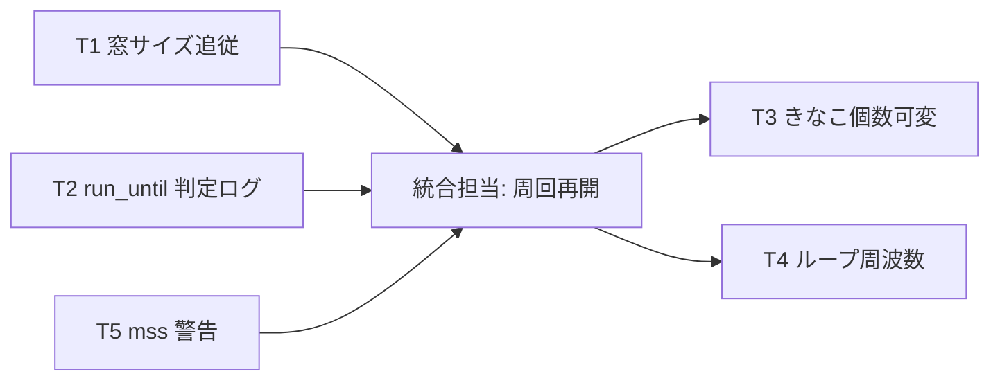

# 周回の頑健化：窓サイズ追従・きなこパン可変回復量・打鍵ループ周波数

- 日付: 2026-10-20
- 状態: 仕様確定・未着手（周回は停止中。プロセス 0 件）。§5 の判断はユーザー回答済み（2026-10-20）
- 対象: `tools/autolive.py` / `tools/ops/run_until.sh` / `tools/driver.py` / `assets/templates/` / `tests/` / `docs/`
- 使い方: §3 の各タスク（T1〜T5）は**単独でサブエージェントに渡せる**ように書いてある。
  渡すときは §0・§2 と該当タスクの節をそのまま添えること。

## 0. 作業者が最初に知ること

このリポジトリは macOS の iPhone ミラーリング越しに IDOLiSH7 の累計イベントを自動周回する。
**事実は実機でしか判明しない。** 着手前に次を読む。

- [`CLAUDE.md`](../../../CLAUDE.md)（絶対規則）
- [`docs/screen-flow.md`](../../screen-flow.md)（画面遷移仕様。判定順は仕様の一部）
- [`docs/device-findings.md`](../../device-findings.md)（実機知見。挙動を変える前に必読）

破ると課金事故・周回が無意味になる規則（抜粋。正本は CLAUDE.md）:

1. **LIFE 回復はきなこパンのみ。ステラは絶対に使わない。** ステラ行の「回復」はきなこ行の
   約 0.26h 下にある。クリック座標を変える変更は、ステラ行に届かないことをテストで示す。
2. 未知の明るい画面ではクリックせず停止する（盲目連打しない）。
3. ライブの途中で autolive を止めない（その周回ぶんの LIFE が無駄になる）。止めるのはリザルト画面で。
4. オートライブは使わない。ブーストはイベント上限（今回「Encounter Love Song」は 10 倍・LIFE -100）。
   **難易度は人が選んだものをそのまま継続する**（ユーザー指定 2026-10-20）。周回中に難易度を変えない。
5. 合成入力・キャプチャ経路（`kCGHIDEventTap`+HIDSystemState、`mss`）は変えない。

テスト: `.venv/bin/python -m unittest discover -s tests`（実機不要。`tests/corpus_raw/` があれば実フレーム判定も走る）。

## 1. 背景（2026-10-20 07:38〜08:28 の実測）

### 1.1 何が起きたか

| 時刻 | 事象 | ログ／証拠 |
|---|---|---|
| 07:40 | LIFE 不足ダイアログを `lifeshort` と認識できず `cardx` に流れ、背景タップを繰り返して `cardx_stuck` 停止 | `tests/frames/lifeshort_kinako_qty1_656x341.png` |
| 07:43〜07:50 | 前セッションが 656x341 のフレームから `life_short_v3.png` `kinako_row_v2.png` `kinako_qty3_v3.png` を切り出して追加し再開 | `a922a69` |
| 07:50〜08:02 | 5 クリア。打鍵 239〜293 回／判定 1,473〜1,959 フレーム（約 15.7〜17.5 FPS） | `/tmp/i7_autorun.log` |
| 08:02 | 楽曲選択の上に出た「ライフを全回復しました。」を `lifefull` と認識できず、NEXT を 6 回空打ちして `songselect_stuck` 停止 | `tests/frames/life_full_over_songselect_656x341.png` |
| 08:27 | 再起動したが、フレンド選択画面を `friendselect` と認識できず `connected()` が `menu` → runner が**接続中なのに「ミラーリング切断中」と誤ログ**して待機し続けた | `tests/frames/friendselect_656x341.png` |

### 1.2 根本原因：ミラーリング窓が 656x341 に縮んでいる

テンプレは 671x348（iPhone 16 系）と 529x334（SE）の等倍で切り出されている。今の窓は
**656x341（幅比 0.9776・高さ比 0.9799）**。UI 全体が約 2.2% 縮んでいるが、`SCALES = [0.8, 0.93, 1.0, 1.08]`
には 0.93 と 1.0 の間が無いので、どのスケールでも 2% ずれたまま照合して閾値を割る。
`.autocal_circles.json` のキーが `671x348 → 665x345 → 660x343 → 656x341` と並んでおり、
**窓は少しずつ縮んできた**（原因は未特定。ユーザー操作かミラーリング側かを問わず動くことが要件）。

既存テンプレの最良スコア（`match_multiscale` 相当で実測）:

| フィクスチャ（656x341） | キー | 閾値 | 現行 `SCALES` | 各スケール × 0.9776 |
|---|---|---|---|---|
| `friendselect_656x341.png` | `friend_select_v2.png` | 0.85 | 0.844 ✗ | **0.870** |
| `life_full_over_songselect_656x341.png` | `life_full.png` | 0.80 | 0.669 ✗ | **0.805**（余裕 0.005。細かく振っても最大 0.823） |
| `lifeshort_kinako_qty1_656x341.png` | `life_short_event.png` | 0.85 | 0.727 ✗ | **0.930** |
| 同上 | `kinako_row.png` / `kinako_row_v2.png` | 0.80 | 0.710 / 1.000 | 0.799 / **0.851** |
| 同上 | `life_short_v3.png` | 0.85 | 1.000 | 0.755 |

最後の 2 行のとおり、**今日追加した 3 枚は 656x341 で切ったため、そのサイズでしか当たらない**
（窓が 671 に戻れば逆に外れうる）。バリアントの継ぎ足しでは窓が 1px 変わるたびに壊れる。

### 1.3 きなこパンの回復量はイベントごとに違う（ユーザー指定 2026-10-20）

> 今回のイベントでは 1 きなこパンあたり 30 回復しますが、イベントによって違います。

現行コードは `KINAKO_PER_RECOVER = 3` 固定で、数量欄は「1」か「3」しか読めない
（`kinako_qty_is_one` / `kinako_qty_is_three`。「3」は字形テンプレで、テーマが変わるたびに割れる）。
固定 3 個だと、回復量が違うイベントで次のように壊れる:

- **回復量が小さい**（例 5）・LIFE -100: 3 個で +15。不足ダイアログが連続 7 回以上出て
  `MAX_LIFE_RECOVERS`(6) を超え、**在庫があるのに `life_depleted` で停止**する。
- **回復量が大きい**: 3 個で「上限を超えています」バッジが出る。「−」で 2 に戻すと数量が「1」でも「3」でもなく、
  `plus_clicked` 条件の組み合わせで `kinako_unsettled` まで空転しうる。
- ブースト倍率で LIFE コストも変わる（3 倍で 15、今回の 10 倍で 100）。

LIFE 不足ダイアログ（`tests/frames/lifeshort_kinako_qty3_656x341.png`）に読める情報:
右上「LIFE ♥ 97」（現在 LIFE）、きなこ行ラベル「共鳴のきなこパン：LIFE 30 回復」（1 個の回復量）、
「所持 840」、数量ステッパー `[−][ 3 ][+]`。LIFE コストはフレンド選択・編成画面の上部バッジ「♥-100」に出る
（`friendselect_656x341.png`）。ヘッダの LIFE は `187/150` のように**上限を超えて保持できる**。

### 1.4 打鍵ループが約 16 FPS（正常は約 33 FPS）

| 指標 | 今回（Encounter Love Song・10 倍） | docs の正常値 |
|---|---|---|
| 判定フレーム／ライブ | 1,473〜1,959（ライブ長 約 110〜112 秒） | 約 4,550 |
| ループ周波数 | **15.7〜17.5 FPS** | 26〜37 FPS（38 超は逆効果） |
| 内訳 `[取得 判定 打鍵]` | 36〜41s / 55〜62s / 26〜40s | — |
| `driver.grab` 単体 | 16.5 ms/枚（311x686・60 枚平均） | — |

- 内訳はクリア計上時にリセットされるので、**ライブ後のメニュー画面ぶん（明るい画面の全段照合）を含んでいる**。
  ライブ中だけの内訳は現状のログからは分からない。
- `[warn] 打鍵N回は通常(約370)より…` の基準 370 は **Don't Analyze Me / EASY（184 ノーツ）の値**。
  今回の曲は別曲で、難易度も人が選んだもの（楽曲選択のヘッダは EXPERT+）。**この警告は曲・難易度が違うと意味を持たない。**

## 2. 全タスク共通の進め方

### 2.1 周回と並行するときの規則

- **実機（ミラーリング窓）を操作してよいのは 1 主体だけ。** 周回を回す役（統合担当）を 1 人に決め、
  他の作業者は実機を触らない（`driver.py click` も撮影以外は禁止）。
- **周回中に本体の `tools/autolive.py` を直接編集しない。** supervisor は autolive が終了すると
  再起動するので、編集途中のファイルが読み込まれる。作業は `git worktree` で行い、
  テスト合格後に統合担当がリザルト画面で周回を止めてから取り込み、再起動する。
- 起動・停止手順は `.claude/skills/run-forever/SKILL.md`（30 日ターゲット＋`--keep-selection`）。
  停止は `pkill -f run_until; pkill -f supervise_autolive; pkill -f tools/autolive; pkill -f 'caffeinate -dimsu'`。

### 2.2 作業ツリー

前セッションまでの未コミット変更は `a922a69` でコミット済み。本書と証拠フィクスチャ 4 枚、
`tools/saluki_chat.sh` の削除は次のコミットに入る。worktree はその後の HEAD から切る。

### 2.3 完了の定義（全タスク共通）

- `.venv/bin/python -m unittest discover -s tests` が全件通る（`tests/corpus_raw/` がある環境で）。
- `TEMPLATES` / `detect()` の判定順 / `_loop()` のハンドラ / `stop_reason` / 上位スクリプトの役割を変えたら
  `docs/screen-flow.md` を更新する（`tests/test_screen_flow_doc.py` が突き合わせる）。
- 実機で判明した事実は `docs/device-findings.md` に日付付きで追記し、`docs/README.md` の改訂履歴に 1 行足す。
- 実装と食い違う古いコメント・ドキュメントは同じ変更で直す（嘘のドキュメントは無いより悪い）。
- テストは「消費者に見える振る舞い」を固定する。定数の値そのものを固定するテスト
  （例 `test_per_recover_count_is_three`）は削除する。

## 3. タスク

### T1. テンプレ照合を窓サイズに追従させる（最優先・周回を止めている）

**Target**: `tools/autolive.py` の `match_multiscale` / `match_best` / `match_in_box` / `match_topmost`、
`OFF_*` / `ANCH_*` / `CLOSEX_OFFSETS` を使うクリック、`assets/templates/`、`tests/`。
`tools/ops/result_log.py`・`recover_freeze.py`・`reconnect_watcher.py`・`unlock_watcher.py` の呼び出し元も追従させる。

**Change**:

1. 全体フレームの寸法から**窓スケール係数** `s` を求め、`SCALES` の各段に掛けて照合する。
   基準幅は機種クラスで分ける: 縦横比 > 1.75 なら 671（iPhone 16 系）、それ以外は 529（SE）。
   これで 671x348 と 529x334 では `s = 1.0` となり、**既存コーパスの結果はビット単位で変わらない**。
   656x341 では `s = 0.9776`。段数は 4 のまま（判定コストを増やさない。§`SCALES` のコメント参照）。
2. **罠 1: `match_in_box` はサブ画像を `match_best` に渡す。** 渡された画像の幅から `s` を推定してはいけない。
   `s` は全体フレームから求めて引数で渡す。
3. **罠 2: `AutoLive.__new__` で作って `detect()` だけ呼ぶ経路が多数ある**
   （`run_until.sh` の `connected()`、`result_log.py`、`tests/test_corpus_smoke.py` ほか多数のテスト）。
   `detect()` が新しいインスタンス属性を要求すると AttributeError になり、`connected()` は例外を握り潰して
   「切断中」扱いで永久に待つ。`s` は `detect()` に渡されたフレームの寸法から毎回求めるか、
   `getattr(self, ..., 既定値)` で読む。
4. テンプレのマッチ位置からの固定 px オフセット（`ANCH_*`、`click_center_off` の `OFF_*`、`CLOSEX_OFFSETS`）も
   同じ `s` を掛ける（656x341 で最大約 6px のずれ。`ANCH_DAILYTASK_X` の 262px で 5.8px）。
5. 656x341 で切った `life_short_v3.png` / `kinako_row_v2.png` / `kinako_qty3_v3.png` を扱い直す。
   方針: **テンプレは基準サイズ（671 または 529）相当で保存する。** 671/656 倍に拡大して保存し直すか、
   既存テンプレだけで足りるなら削除する。どちらにしたかを `docs/screen-flow.md` §5.2（テンプレの切り方）に
   「切り出したフレームの寸法が基準と違うときは基準へ換算して保存する」と書き足す。
6. `life_full` は係数を掛けても 0.805（閾値 0.80）しか余裕が無い。基準相当のバリアントを追加するか、
   余裕が 0.03 以上になる手当てをする。

**Acceptance**:

- 新フィクスチャ 4 枚で `detect()` が期待どおりの状態を返すテストを `tests/test_detect_dialogs.py` に追加:
  `friendselect_656x341.png` → `friendselect`、`life_full_over_songselect_656x341.png` → `lifefull`、
  `lifeshort_kinako_qty1_656x341.png` / `lifeshort_kinako_qty3_656x341.png` → `lifeshort`。
  加えて 656x341 の 2 枚で `_recover_life` が「きなこ行の回復」だけを押し、ステラ行に届かないこと
  （既存の `tests/test_life_recover_safety.py` の `_FakeLive` を流用）。
- `TestCorpusStatesUnchanged` と既存の 671/529 フィクスチャのテストが全件通る（判定結果が変わらない）。
- `connected()` と同じ手順（`__new__` → `detect()`）を 656x341 フィクスチャで実行して例外が出ない。
- 実機: 統合担当が周回を起動し、フレンド選択 → 編成 → ライブ → リザルト → LIFE 回復 → 次ライブを
  1 周以上通すこと、`/tmp/i7_autorun.log` に `cardx_stuck` / `songselect_stuck` が出ないことを確認する。

### T2. `run_until.sh` が「接続中だが画面が分からない」を切断と区別する

**Target**: `tools/ops/run_until.sh` の `connected()` と待機ログ、`tests/test_run_until.sh`
（`tests/test_stop_reason.py::TestRunUntilBranches` から実行される。`connected()` は `.venv/bin/python` の
スタブで終了コードを差し替えて検証している）。

**現状**: `connected()` は「窓が縦長」でも「`detect()` が `menu`」でも「Python が例外」でも 1（切断）を返し、
すべて「ミラーリング切断中（iPhone をロックすると自動再接続）」とログする（`2>/dev/null` で例外も捨てている）。
08:27 は窓が横向き 656x341 で接続していたのに、この**誤った復旧方法**を出して待ち続けた。

**Change**: 終了コードを分ける（例: 1 = 縦長＝切断、3 = 横向きだが `menu`、4 = 判定処理の例外）。
3 と 4 は理由とスクリーンショットの保存先をログに出す（4 は例外メッセージも）。3 で supervisor を起動するかは
現状どおり起動しない（未知画面で動かさない＝安全側）が、ログは「接続中・画面を認識できない」にする。
待機理由が変わったときだけログを出す既存の方針は維持する。

**Acceptance**: 終了コード別のログ文言を `tests/test_run_until.sh` で固定する（既存の `I7_RUNNER_LOG` と
python スタブの仕組みを使う。既存ケース「iPhone をロックすると自動再接続」は縦長＝切断のときだけに残す）。
`docs/operations.md` のトラブルシューティングと `docs/screen-flow.md` §1（3 層のプロセス）を更新する。

### T3. きなこパンの使用個数を、回復量・現在 LIFE・LIFE コストから決める

**Target**: `tools/autolive.py` の `_recover_life`、`kinako_qty_is_one` / `kinako_qty_is_three` / `_qty3_glyphs`、
`KINAKO_PER_RECOVER` / `KINAKO_QTY3_MIN` / `MAX_LIFE_RECOVERS` まわり、フレンド選択・編成画面のハンドラ、
`tests/test_life_recover_safety.py`、`docs/screen-flow.md` §5「課金事故を防ぐ設計」。

**要件（ユーザー指定）**: 1 個あたりの回復量はイベントで変わる。固定値を前提にしない。

**Change**:

1. **読む値**: LIFE 不足ダイアログから「現在 LIFE」（右上 `LIFE ♥ N`）と「1 個の回復量」
   （きなこ行ラベル `…きなこパン：LIFE N 回復`）。フレンド選択・編成画面の上部バッジから
   「LIFE コスト」（`♥-N`）を読み、インスタンスに保持する。
2. **個数**: `n = ceil((コスト − 現在 LIFE) / 回復量)` を `1..KINAKO_MAX_PER_RECOVER` に収める
   （上限は 10 程度。LIFE は上限超えで保持できるので多めでも失われない）。コスト未取得なら
   観測済みの最大値 100 を仮定する。
3. **数量欄は整数として読む**（「1」「3」の二択をやめる）。「+」は数量が 1 と確定したときに
   (n − 1) 回だけ押し、押した事実は既存の `kinako_plus_at` / `KINAKO_PLUS_MEMORY_SEC` で覚えて二度押ししない。
   「回復」は**数量欄が n と確定し、赤い「上限を超えています」バッジが無いときだけ**押す。
   バッジが出たら「−」で減らし、消えた時点の数量（≥1）で確定して回復してよい。
4. **読み取りの手段**: 第一候補は macOS の Vision OCR（`pyobjc-framework-Vision`。ローカル完結・テーマ非依存）。
   **決定（ユーザー承認 2026-10-20）: Vision OCR を使う。** `pyobjc-framework-Vision==12.2` は `.venv` に導入済み
   （同時に pyobjc-core / Cocoa が 12.2.2 に上がった。`driver.py info` は動作確認済み）。
   `CLAUDE.md` のセットアップ行と `docs/setup.md` は更新済み。
   **実測（2026-10-20、`VNRecognizeTextRequest`・言語 ja-JP/en-US・言語補正 OFF・切り出し 3 倍拡大）**:

   | 対象（656x341 の切り出し範囲 y0:y1, x0:x1） | 読み | 時間 |
   |---|---|---|
   | `qty3` の現在 LIFE（90:120, 360:460） | `LIFE` `97` | 24 ms |
   | `qty1` の現在 LIFE（同） | `LIFE` `50` | 23 ms |
   | `qty3` の数量欄（160:185, 290:350） | `3` `+` | 23 ms |
   | `qty1` の数量欄（同） | `+` のみ（**「1」は読めない**） | 22 ms |
   | `friendselect` のコストバッジ（70:95, 380:440） | `-100` | 22 ms |
   | フレーム全体（等倍・言語補正 ON） | `共鳴のきなこパン：LIFE 30 回復` / `共期の…` / `共明の…バン` | 150〜290 ms |

   - **プロセスで最初の 1 回は約 25 秒かかる**（モデル読み込み）。起動時に空画像で 1 回呼んでおく。
   - 全画面 OCR はライブ中に呼ばない（150 ms 以上で打鍵が止まる）。ダイアログ上でだけ、切り出して呼ぶ。
   - 数字 1 桁の「1」は OCR で落ちる。数量欄が「1」かは既存の `kinako_qty_is_one`（画素の縦棒判定）を併用する。
   - 回復量はラベルの接頭辞が誤読される（共鳴→共期・共明）ので、`LIFE\s*(\d+)\s*回復` の数字部分だけを使う。
   - 切り出し範囲はきなこ行のテンプレ一致位置から相対で決める（固定座標は窓サイズで壊れる。T1 と同じ理由）。
5. **読めないときは安全側**: 回復量か現在 LIFE が読めなければ n = 1（従来の「1 個で回復」相当）。
   数量欄が読めないまま「回復」を押さない（既存の unsettled の扱いを維持）。
6. **枯渇判定を回数依存から外す**: `MAX_LIFE_RECOVERS`（ライブを挟まない連続回復回数）は、回復量が
   小さいイベントで在庫があっても停止させる。枯渇の正は従来どおり「きなこ行が見つからない」
   （`kinako_missing`）。回数の上限は「回復を押したのにダイアログの現在 LIFE が増えない」が続いたときの
   歯止めに変える。

**守る不変条件**（既存テストが固定しているもの。壊したら差し戻し）:

- 「回復」「+」「−」はすべて**きなこ行のテンプレ一致から求めた帯の中**だけ。ステラ行には届かない。
- きなこ行が見えない（枯渇・行が消えて詰まった）ときは 1 回もクリックせず停止
  （`lifeshort_kinako_depleted_529x334.png`）。
- 「+」はダイアログ 1 回の出現につき 1 セットだけ。

**Acceptance**:

- 既存の LIFE 不足フィクスチャ（`tests/frames/lifeshort_kinako_*`）すべてで、回復量・現在 LIFE・数量の
  読みをテストで固定する。少なくとも 2 種類の回復量（イベント違い）が含まれていることを確認し、
  含まれていなければその旨を報告する。
- `_FakeLive` で次を固定する: 回復量 30・LIFE 50・コスト 100 → 2 個で回復。回復量 30・LIFE 97 → 1 個。
  回復量 5・コスト 100 で `life_depleted` に**ならない**。バッジが出たら回復を押さず「−」。
  値が読めないとき 1 個で回復。
- `test_per_recover_count_is_three` は削除する（定数の値を固定しているだけ）。
- ログの「3個（数量欄 3 を確認）」を実際の個数と読み値（回復量・現在 LIFE・コスト）を含む文言に変え、
  `docs/screen-flow.md` §3 のハンドラ表（`lifeshort` / `lifefull` の行）と §5 の「`KINAKO_PER_RECOVER`(3) 個」の記述を書き換える。
- 実機: 統合担当が 1 回以上の LIFE 回復を確認し、終了後に右上のステラ所持数（1,010）が減っていないことを確認する。

### T4. 打鍵ループ周波数を測り、落ちている原因を直す

**Target**: `tools/autolive.py` の `_prof` 計測・ライブ終了ログ・`TAPS_LOW` / `TAPS_DOUBLE` 警告・
暗い側の `detect()` 経路・`_gameplay_timing`。

**CLAUDE.md の手順を守る**: パラメータを触る前に、打鍵回数とループ周波数の 2 つを測る。
**38 FPS を超えると逆に悪化した実測がある**（`docs/device-findings.md`「打鍵ループが 3.3 FPS しか出ていなかった」の続き）。
`_gameplay_timing` 末尾の `time.sleep(0.005)` は外さない。

**Change**:

1. `_prof` を**ライブ中（gameplay/pause）とそれ以外**に分けて集計し、ライブ終了ログに
   ライブ中の FPS（判定フレーム ÷ gameplay 継続秒）と内訳を出す。
2. その数字で原因を特定する。候補（未検証）: 今回の曲の MV が明るく、フレームが `DARK_THRESH` を
   超えて明るい側の全段照合（1 回 1〜3 秒）や薄暗い側のリング判定に落ちている／`grab` の遅化／
   `_refresh_window` や暗い側の救済照合の頻度。実機フレームが必要なら
   `tools/ops/corpus_collector.py`（入力を送らない）で採取する。
3. 原因を直す。直せない・原因が外部（OS・ミラーリング）なら、測定値と根拠を device-findings に残して報告する。
4. 打鍵回数の警告は曲依存の固定値（370・330・600）をやめ、**曲に依存しない指標**（ライブ中 FPS の下限など）に置き換える。
   リザルト見逃し（2 ライブ連結）の検知は、gameplay 継続秒が 1 ライブ長の約 2 倍を超えたら警告、のように時間で判定する。

**Acceptance**:

- 単体テストで、ライブ中とそれ以外の内訳が分かれて集計されること、警告が曲の打鍵数に依存しないことを固定する。
- 実機: 統合担当の周回で、ライブ中 FPS が 26〜37 に入ること。改善を主張するなら `tools/ops/result_log.py` で
  変更前後それぞれ 10 ライブ以上の成績（MISS・SCORE）を比べる（1 ライブ差は誤差 ±5% に埋もれる）。

### T5. 小物

- `tools/driver.py` の `_mss.mss()` は mss 10.2 で DeprecationWarning（`mss.MSS` を使え）。置き換えて、
  `driver.py shot` と autolive の起動で警告が出ないことを確認する。
- **既存の全体テストが 1 件落ちている**（2026-10-20 時点。本書の変更とは無関係）:
  `tests/test_repo_layout.py::TestToolsLayout::test_production_scripts_stay_at_tools_root` が
  `tools/saluki_chat.sh` を想定外の本番スクリプトとして検出していた。**ユーザー指定で削除済み（2026-10-20）**。
  `tools/README.md` の記載も削除した。残作業なし。

## 4. 依存関係と割り振り

- **T1・T2・T5 は並列可**（触るファイルが分かれる。T1 と T5 はどちらも撮影に関わるが別関数）。
  T1 が終われば周回を再開できる。
- **T3 と T4 はどちらも `tools/autolive.py` を大きく触る。** 別 worktree で並列に進め、統合担当が順に取り込む。
  T3 は 671x348 の既存フィクスチャだけで開発できる。T4 の実機計測は周回中のログで行える。
- 実機の操作・周回の起動停止・取り込みは統合担当 1 人（§2.1）。

## 5. 人の判断（2026-10-20 ユーザー回答済み）

1. **難易度: 人が選択したものをそのまま継続する。** `--keep-selection` の運用を正とし、CLAUDE.md の
   絶対規則 2 を書き換えた。T4 の打鍵基準は曲・難易度に依存しない指標にする（T4 Change 4）。
2. **未コミット変更はコミットする** → `a922a69`。
3. **Vision OCR を入れてよい** → T3 Change 4 に実測と方針を記載。
4. **`tools/saluki_chat.sh` は削除する** → 削除済み（T5）。

## 6. 証拠

| ファイル | 内容 |
|---|---|
| `tests/frames/friendselect_656x341.png` | フレンド選択（08:23）。上部に `♥-100` `★×5`、右上ステラ 1,010 |
| `tests/frames/life_full_over_songselect_656x341.png` | 楽曲選択＋全回復モーダル（08:02、`songselect_stuck` の停止フレーム） |
| `tests/frames/lifeshort_kinako_qty1_656x341.png` | LIFE 不足ダイアログ・数量 1・現在 LIFE 50（07:40、`cardx_stuck` の停止フレーム） |
| `tests/frames/lifeshort_kinako_qty3_656x341.png` | LIFE 不足ダイアログ・数量 3・現在 LIFE 97（08:01、回復直前） |
| `/tmp/i7_autorun.log` `/tmp/i7_supervisor.log` `/tmp/i7_runner.log` | 当日の実行ログ（再起動で消える） |
| `.autocal_circles.json` | 窓寸法の履歴（671x348 → 665x345 → 660x343 → 656x341） |
